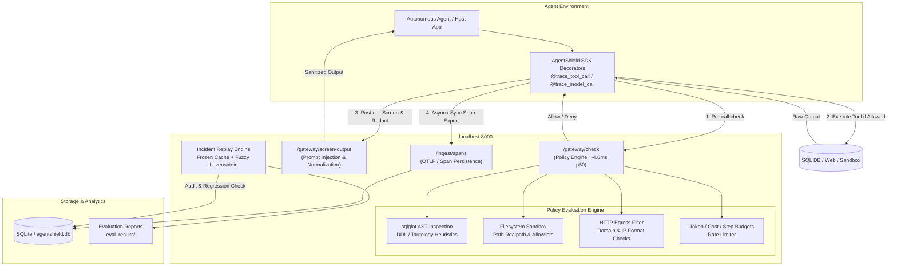

# AgentShield

> **A Low-Latency Ingress/Egress Security Gateway and Incident Replay Engine for Autonomous AI Agents**

AgentShield intercepts and evaluates agent tool calls in real time against declarative security policies, redacts sensitive credentials and PII from telemetry streams, and provides an offline incident replay engine to detect regressions before deploying updated policies or agent models.

---

## Architecture Diagram



---

## Quickstart (Verified End-to-End)

### 1. Environment Setup
AgentShield is developed and tested on Windows 11 with CPython 3.11.

```bash
# Clone the repository
git clone https://github.com/YashJ2303/AgentShield.git
cd AgentShield

# Create and activate virtual environment
python -m venv .venv
.venv\Scripts\activate

# Install dependencies
pip install -r requirements.txt
```

### 2. Run Test Suite
Run the full automated test suite (including claim validation and security checks):

```bash
pytest -q
```

Expected output:
```text
161 passed, 3 warnings in ~30s
```

### 3. Verify Empirical Claims
Mechanically verify that all claims in `CLAIMS.md` map to existing tests, repository files, and CSV scenario records:

```bash
python scripts/check_claims.py
```

Expected output:
```text
Checking claims and evidence in CLAIMS.md...
Verifying 27 test references against 161 collected tests...
Verifying 13 file references on disk...
Verifying 11 CSV scenario references in held_out_unsafe_results.csv...
Verifying 2 replay variant references in replay_regression_results.csv...
Verifying latency benchmark runs in latency_benchmark.csv...

[PASS] All 27 tests, 13 files, 11 held-out rows, 2 replay rows, and latency benchmarks verified successfully!
```

### 4. Single Reproduction Command
Reproduce the complete evaluation matrix (safety benchmarks, held-out active attacks, latency overhead, and RQ2 incident replay regression detection):

```bash
python scripts/evaluate.py --seed 42
```

> **Note on Latency Benchmark Reproducibility**: The latency benchmark step (`eval_results/latency_benchmark.csv`) is timing-based and measured on the host system. Consequently, while functional evaluation results and CSV metrics are reproducible bit-for-bit, latency numbers are reproducible within an experimental range (e.g., median added latency ~+18 ms p50 [17.8, 18.6] ms), not byte-for-byte identical.

Evaluation artifacts are located in `eval_results/`:
- `eval_results/evaluation_report.md`: Formal evaluation report with Wilson 95% confidence intervals
- `eval_results/evaluation_results.csv`: Standard benchmark metric logs
- `eval_results/held_out_unsafe_results.csv`: Row-by-row audit log of the 20 held-out scenarios
- `eval_results/replay_regression_results.csv`: Dual-labeled 50-variant incident replay regression suite
- `eval_results/latency_benchmark.csv`: Multi-run latency overhead benchmark

### 5. Start the Gateway Server & Dashboard Locally

```bash
# 1. Initialize local environment configuration (dev defaults)
copy .env.example .env    # On Windows (or 'cp .env.example .env' on Linux/macOS)

# 2. Start the AgentShield Gateway server (FastAPI backend)
python -m uvicorn server.app.main:app --host 127.0.0.1 --port 8000

# 3. (Optional) Populate Live SOC Dashboard Telemetry
# Reset to a clean initial state (schema + baseline policy) and run realistic agent workflows:
python scripts/reset_demo_db.py
python scripts/populate_demo.py

# 4. In a separate terminal, launch the Web Dashboard (React / Vite)
cd dashboard
npm install
npm run dev
```

- **Health Check Endpoint**: `http://localhost:8000/health`
- **Interactive Swagger Docs**: `http://localhost:8000/docs`
- **Security Dashboard**: `http://localhost:5173/`

The **Command Center** view is driven entirely by gateway responses: every poll reads
`/analytics/summary`, `/analytics/breakdown`, `/analytics/anomalies`, `/runs`, `/approvals`,
`/policies` and `/health`, and the topology, health-score composition, denial attribution and
latency percentiles are computed from those payloads. When a selected window contains no rows
the view reports `No telemetry` rather than rendering a synthetic score.

---

## Live Real-World API Integrations

AgentShield routes real third-party API calls through the same policy gateway it uses for
simulated agents, so guardrails are demonstrated against genuine network traffic rather
than fixtures. **This is a demo/integration surface and is not part of the RQ1–RQ3
evaluation claims** — the benchmark numbers above come from scripted mock agents and are
unaffected.

### Providers

| Provider | Category | Key required | What it demonstrates |
|---|---|---|---|
| GitHub REST API | Public | — | Repo metadata reads |
| Open-Meteo | Public | — | Live weather reads |
| Hacker News Firebase | Public | — | Live front-page stories |
| urlscan.io | Threat intel | optional | Pre-crawl URL reputation gate |
| Google Gemini | LLM | `GEMINI_API_KEY` | Real inference, real tokens/cost |
| OpenAI | LLM | `OPENAI_API_KEY` | Real inference + moderation |
| Stripe | Payments | `STRIPE_API_KEY` | Amount-tiered payment policy |
| SendGrid / Slack / Twilio | Comms | per-provider | PII redaction **before** dispatch |

### Zero-key start (everything runs immediately)

Public providers need no credentials. Any keyed provider that is unset falls back to a
labelled simulation — the API response, the telemetry span, and the dashboard badge all
carry an `execution_mode` of `live` or `simulated`, so a simulated call is never presented
as a real one.

```bash
# Start the gateway, then run the live sweep
python -m uvicorn server.app.main:app --host 127.0.0.1 --port 8000
python scripts/live_demo.py --scenario live
```

The sweep reports which providers are live vs. simulated, executes every scenario through
the gateway, tallies allow/deny/approval verdicts, and runs a real token-and-cost model
comparison.

### Endpoints

- `GET /live-agent/providers` — per-provider `execution_mode` and configuration state
- `GET /live-agent/scenarios` — curated live scenarios
- `POST /live-agent/execute` — run one scenario through the gateway
- `POST /live-agent/invoke` — free-form tool call (drives the dashboard's **Live Agent Lab**)
- `POST /live-agent/compare-models` — same prompt across two models, with cost/latency deltas

### Optional: enable real LLM inference

```bash
# .env — leave unset to keep labelled simulations
GEMINI_API_KEY=...
OPENAI_API_KEY=...
```

Costs are computed from a pricing table stamped with its as-of date and overridable via
`PRICING_CONFIG_PATH`; unknown models return a null cost rather than appearing free.

To disable all outbound egress (hermetic demos or CI), set `LIVE_ALLOW_NETWORK=false`.

---

## Research Questions Evaluated

- **RQ1 (Policy Enforcement & Overhead)**: *How much unsafe tool-call behavior does a tool-boundary policy layer prevent, and at what cost in false blocks and latency?*
  - **Prevention**: 100.0% [92.1, 100.0]% on modeled destructive actions; 45.5% [21.3, 72.0]% (5/11) on un-modeled active attacks via domain allowlist (vs. 9.1% blocklist; CIs overlap).
  - **False Blocks**: 0.0% [0.0, 4.1]% on 90 standard benign tasks.
  - **Latency**: Median +18.046 ms p50 full instrumented tool-call overhead (~4.6 ms p50 for standalone policy check).
- **RQ2 (Incident Replay Fidelity)**: *How faithfully does frozen-output replay detect regressions across behavior changes?*
  - **Regression Detection**: Under ground truth by construction (paraphrase = benign), replay achieves 25/25 recall, 23/25 specificity, and 25/27 precision, suffering 2 false alarms on SQL paraphrases (<0.85 similarity cache misses). Replay ties outcome-only checking because cache misses flip the outcome.
- **Scope Note on RQ3 (Comparative Analytics)**: Cost and reliability analytics are implemented (`server/app/services/analytics_service.py`) and unit-tested (`tests/test_analytics_anomalies.py`), but have **not been empirically validated** against live model/prompt selection outcomes. We designate RQ3 as *implemented, not validated* and do not claim predictive efficacy.

---

## Key Findings & Provenance

| Component / Metric | Headline Finding | Caveats & Disclosures |
|---|---|---|
| **Modeled Destructive Prevention** | **100.0% [92.1, 100.0]%** (45/45) across SQL, Web, File | Evaluated against scripted mock agents; not live LLMs |
| **Held-Out Active Attacks** | **45.5% [21.3, 72.0]%** (5/11) vs. Blocklist **9.1%** (1/11) | CIs overlap; no statistical significance claimed; 6 policy gaps disclosed |
| **File/Shell No Policy Baseline** | **66.7%** (10/15) prevented without policy | Simulator has internal command allowlist (`cat, ls, ...`); reflects simulator limits |
| **RQ2 Replay Regression Detection** | **25/25 Recall, 23/25 Specificity, 25/27 Precision** | 2 false alarms on SQL paraphrases (<0.85 similarity); ties outcome-only baseline |
| **Full-Call Runtime Overhead** | **+18.046 ms p50** (range [17.8, 18.6] ms, p95 +23.8 ms) | Standalone gateway policy check is **~4.6 ms p50**; synchronous span ingest adds ~13 ms |
| **Unseen Redaction Formats** | **33.3% [9.7, 70.0]%** on unseen keys | Regex matching is format-specific; prefix-less vendor keys require explicit regex |

---

## Documentation & Evidence Links

- [CLAIMS.md](file:///d:/E/AgentShield/CLAIMS.md): Machine-checked registry mapping every claim to test names and CSV rows.
- [KNOWN_LIMITATIONS.md](file:///d:/E/AgentShield/KNOWN_LIMITATIONS.md): Architectural trade-offs, Windows-only environment, unverified docker compose, and scripted agent boundaries.
- [Evaluation Report](file:///d:/E/AgentShield/eval_results/evaluation_report.md): Formal report with dual RQ2 labeling and complete audit reconciliations.
