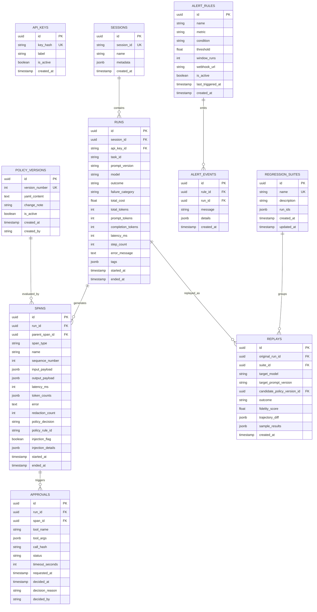

# AgentShield: Architectural Specification & Implementation Plan

## Executive Overview
**AgentShield** is a framework-agnostic, production-grade safety, observability, and regression-testing control layer positioned directly at the tool-call boundary between AI agents and their tools/models.

The system enforces deterministic security policies prior to tool execution, captures complete OpenTelemetry-compatible traces with sensitive data redaction, tracks granular cost and reliability metrics, screens model/tool outputs for prompt injection, and enables high-fidelity incident replays across model/prompt revisions.

```
                         ┌────────────────────────────────────────────────────────┐
                         │                     AI Agent                           │
                         │    (LangChain / LangGraph / Plain Python / Custom)     │
                         └──────────────┬─────────────────────────▲───────────────┘
                                        │                         │
                                        │ @trace_model_call       │
                                        │ @trace_tool_call        │
                                        ▼                         │
                      ┌─────────────────────────────────────────────────────────────┐
                      │                   AgentShield SDK                           │
                      │  - Context Manager (with agentshield.run)                   │
                      │  - Secret & PII Redactor                                    │
                      │  - OTLP Span Exporter (Jaeger / Collector)                  │
                      │  - Synchronous / Asynchronous Gateway Interceptor           │
                      └──────────────┬─────────────────────────▲────────────────────┘
                                     │                         │
               1. Pre-call Check     │                         │ 4. Verdict:
               (POST /gateway/check) │                         │    Allow / Deny / Approval
                                     ▼                         │
                      ┌─────────────────────────────────────────────────────────────┐
                      │               AgentShield FastAPI Server                    │
                      │  ┌─────────────────┐  ┌───────────────────┐  ┌───────────┐  │
                      │  │ Policy Engine   │  │ Prompt Injection  │  │ Budget &  │  │
                      │  │ (YAML AST &     │  │ Screener (AST &   │  │ Step Caps │  │
                      │  │ Rule Matcher)   │  │ Heuristics)       │  │ Monitor   │  │
                      │  └─────────────────┘  └───────────────────┘  └───────────┘  │
                      │  ┌─────────────────┐  ┌───────────────────┐  ┌───────────┐  │
                      │  │ Approval Flow   │  │ Anomaly & Loop    │  │ Replay    │  │
                      │  │ (Wait / Webhook)│  │ Detector (IQR/Z)  │  │ Engine    │  │
                      │  └─────────────────┘  └───────────────────┘  └───────────┘  │
                      └──────────────┬─────────────────────────▲────────────────────┘
                                     │                         │
                                     ▼                         ▼
                      ┌─────────────────────────────────────────────────────────────┐
                      │              PostgreSQL 16 Storage (Alembic)                │
                      │  - Runs, Sessions, Spans, Policies, Approvals, Replays       │
                      └─────────────────────────────────────────────────────────────┘
                                     ▲
                                     │ Query & Control
                                     │
                      ┌──────────────┴──────────────────────────────────────────────┐
                      │            AgentShield Dashboard (React + Vite)             │
                      │  - Live Waterfall Trace Timeline, Redaction Inspection      │
                      │  - Human-in-the-Loop Approvals Queue                        │
                      │  - Policy Editor, Validation, Dry-run & Version Rollback    │
                      │  - Cost / Latency / Failure Analytics & Anomalies (Recharts)│
                      │  - Regression Testing Suites & Trajectory Diff Replay       │
                      └─────────────────────────────────────────────────────────────┘
```

---

## 1. Directory Structure

```
agentshield/
├── .env.example
├── .gitignore
├── docker-compose.yml
├── README.md
│
├── sdk/                                # Framework-agnostic Python SDK
│   ├── pyproject.toml
│   └── agentshield_sdk/
│       ├── __init__.py                 # Export run, trace_model_call, trace_tool_call, init
│       ├── client.py                   # Gateway HTTP client (sync & async, retry, auth)
│       ├── context.py                  # Context vars for run_id, session_id, parent_span
│       ├── decorators.py               # @trace_model_call, @trace_tool_call
│       ├── redaction.py                # Regex-based PII & secret redactor
│       ├── otlp_exporter.py            # OpenTelemetry SDK span pipeline & exporter
│       └── adapters/
│           ├── __init__.py
│           └── langchain.py            # LangChain / LangGraph CallbackHandler & Tool wrapper
│
├── server/                             # FastAPI Core Service
│   ├── pyproject.toml
│   ├── alembic.ini
│   ├── alembic/
│   │   ├── env.py
│   │   ├── script.py.mako
│   │   └── versions/                   # Migration versions
│   └── app/
│       ├── __init__.py
│       ├── main.py                     # App factory, CORS, exception handlers, router mounts
│       ├── config.py                   # Pydantic Settings (DB URL, pricing, auth, Jaeger)
│       ├── database.py                 # SQLAlchemy engine, session maker, base model
│       ├── logging.py                  # Structured JSON logging configuration
│       │
│       ├── models/                     # SQLAlchemy 2.0 ORM models
│       │   ├── __init__.py
│       │   ├── api_key.py              # API Keys and tenant labels
│       │   ├── run.py                  # Runs, Sessions
│       │   ├── span.py                 # Spans, span types, policy decision records
│       │   ├── policy.py               # Policy versions and active pointers
│       │   ├── approval.py             # Pending and historical human approvals
│       │   ├── alert.py                # Alert rules and fired alert events
│       │   └── replay.py               # Replays, regression suites, diffs
│       │
│       ├── schemas/                    # Pydantic v2 schemas
│       │   ├── common.py               # Enums (Outcome, SpanType, PolicyDecision, etc.)
│       │   ├── ingest.py               # Span ingest requests/responses
│       │   ├── run.py                  # Run query, search, export schemas
│       │   ├── gateway.py              # Tool-check & screen-output request/response
│       │   ├── policy.py               # YAML AST, dry-run schemas, versioning
│       │   ├── approval.py             # Approval list and decision schemas
│       │   ├── analytics.py            # Summary, breakdown, anomaly, comparison schemas
│       │   ├── alert.py                # Alert rule definitions
│       │   └── replay.py               # Replay submission, diff, regression suite schemas
│       │
│       ├── services/                   # Core business logic
│       │   ├── auth.py                 # API Key authentication & hashing (SHA-256)
│       │   ├── redaction.py            # Server-side redaction verification
│       │   ├── policy_engine.py        # YAML parser, rule evaluator, AST validator
│       │   ├── security_checks.py      # SQL AST analyzer, path boundary, domain allowlist
│       │   ├── injection_detector.py   # Heuristic & pattern prompt-injection scanner
│       │   ├── budget_monitor.py       # Cost, token, step count & wall-clock caps
│       │   ├── approval_manager.py     # Approval lifecycle, polling & timeout auto-deny
│       │   ├── dry_run.py              # Candidate policy evaluation against recorded traces
│       │   ├── analytics_service.py    # Metric aggregation, pricing table, failure classifier
│       │   ├── anomaly_detector.py     # Repeated tool loop detector, IQR/z-score outliers
│       │   ├── alert_service.py        # Threshold evaluator and webhook dispatcher
│       │   └── replay_engine.py        # Frozen tool playback, trajectory diff, fidelity score
│       │
│       └── api/                        # FastAPI Route Handlers
│           ├── __init__.py
│           ├── v1/
│           │   ├── __init__.py
│           │   ├── health.py           # /health status endpoint
│           │   ├── ingest.py           # /ingest/spans
│           │   ├── runs.py             # /runs, /runs/{id}, /runs/export
│           │   ├── gateway.py          # /gateway/check, /gateway/screen-output
│           │   ├── policies.py         # /policies, /policies/dry-run, /policies/versions, rollback
│           │   ├── approvals.py        # /approvals, /approvals/{id}/decision
│           │   ├── analytics.py        # /analytics/summary, /breakdown, /anomalies, /comparison
│           │   ├── alerts.py           # /alerts/rules, /alerts/events
│           │   └── replays.py          # /replay, /replay/{id}, /regression-suites
│
├── dashboard/                          # React + TypeScript + Vite UI
│   ├── package.json
│   ├── tsconfig.json
│   ├── vite.config.ts
│   ├── index.html
│   └── src/
│       ├── index.css                   # Global CSS & tokens (dark/light theme)
│       ├── main.tsx                    # Root React entry
│       ├── App.tsx                     # Router & App Shell
│       ├── api/                        # Typed Fetch API clients for Server endpoints
│       ├── types/                      # TypeScript definitions mirror Pydantic schemas
│       ├── components/
│       │   ├── common/                 # Header, Sidebar, Badge, Modal, SearchInput, DiffView
│       │   ├── runs/                   # RunList, RunFilters, TraceWaterfall, SpanDetail
│       │   ├── gateway/                # PolicyEditor, PolicyVersions, DryRunResults
│       │   ├── approvals/              # ApprovalCard, ApprovalList, CountdownTimer
│       │   ├── analytics/              # MetricCards, LatencyChart, CostChart, AnomalyPanel
│       │   └── replays/                # ReplayRunner, TrajectoryDiffViewer, SuiteManager
│       └── pages/                      # Top-level views
│           ├── RunsPage.tsx
│           ├── RunDetailPage.tsx
│           ├── GatewayPage.tsx
│           ├── ApprovalsPage.tsx
│           ├── AnalyticsPage.tsx
│           └── ReplaysPage.tsx
│
├── examples/                           # Demo Agents & Test Environments
│   ├── mock_llm.py                     # Pluggable deterministic LLM for automated testing
│   ├── mock_web_server.py              # Local mock web server with injection test payloads
│   ├── sql_agent.py                    # Tool-using SQL Agent (benign analytics & unsafe SQL)
│   ├── web_agent.py                    # Web/API agent (search & HTTP get with injection)
│   ├── file_agent.py                   # File/Shell agent with sandboxed filesystem operations
│   ├── looping_agent.py                # Runaway agent scenario exercising loop detection
│   └── scenarios.py                    # Scenario generator for evaluation & tests
│
├── policies/                           # Example & Benchmark Policy YAMLs
│   ├── default_policy.yaml             # Baseline production policy
│   ├── strict_policy.yaml              # Zero-trust strict policy
│   └── candidate_policy.yaml           # Policy used for dry-run and diff testing
│
├── scripts/
│   ├── evaluate.py                     # Formal evaluation harness (metrics, CSV, Markdown)
│   └── seed_data.py                    # Database seeder for demo & local development
│
└── tests/                              # Pytest test suite
    ├── conftest.py                     # Test DB session fixtures, client fixtures, mock LLM
    ├── test_sdk.py                     # Instrumentation, decorators, context, redaction
    ├── test_redaction.py               # Comprehensive PII/Secret regex test suite
    ├── test_policy_engine.py           # YAML parsing, rule matching, allow/deny
    ├── test_security_checks.py         # SQL AST safety, path containment, domain matching
    ├── test_injection_detector.py      # Prompt injection heuristic tests
    ├── test_budget_limits.py           # Cost, token, and step limit enforcement
    ├── test_dry_run.py                 # Dry-run policy simulation & diffing
    ├── test_approvals.py               # Approval lifecycle and timeout auto-deny
    ├── test_analytics_anomalies.py     # Aggregations, loop detection, statistical outliers
    ├── test_replay_diff.py             # Frozen tool replay, trajectory diff, fidelity scoring
    └── test_api_integration.py        # Full end-to-end API integration tests
```

---

## 2. Database Schema (PostgreSQL 16 / SQLAlchemy 2.0)



### Key Entity Details

1. **`api_keys`**:
   - `key_hash`: SHA-256 hash of API key. Plaintext key only shown once upon creation.
   - `label`: Identifies agent/tenant (e.g. `production-sql-agent`, `staging-eval-bot`).

2. **`runs`**:
   - `outcome`: `Enum("success", "failure", "blocked", "timed_out")`.
   - `failure_category`: `Enum("tool_error", "policy_block", "timeout", "loop", "malformed_output", "budget_exceeded", "other")`.
   - `prompt_tokens`, `completion_tokens`, `total_cost`: Computed via model pricing table.

3. **`spans`**:
   - `span_type`: `Enum("model", "tool")`.
   - `policy_decision`: `Enum("allow", "deny", "approved", "rejected", "bypassed")`.
   - `redaction_count`: Number of sensitive tokens/PII redacted from input/output.
   - `injection_flag`: Boolean true if heuristic scanner flagged output payload.

4. **`policy_versions`**:
   - Maintains immutable audit trail of YAML policies.
   - Only one version has `is_active = True` at any time. Rolling back creates or reactivates a target version.

5. **`approvals`**:
   - `status`: `Enum("pending", "approved", "rejected", "timed_out")`.
   - Gateway check pauses execution and polls approval state until decision or `timeout_seconds` elapses (default 60s), triggering automatic deny.

6. **`replays`**:
   - Captures original vs replayed execution diffs, per-step argument differences, and consistency across $N$ stochastic samples.

---

## 3. Core Subsystems & Technical Details

### 3.1 Policy Engine & AST Evaluator
Policies are defined in YAML and validated on load:
```yaml
version: 1
default_action: deny # allow | deny
limits:
  max_cost_per_run: 0.50 # USD
  max_tokens_per_run: 15000
  max_steps_per_run: 20
  max_wall_time_seconds: 120

rules:
  - id: allow_read_queries
    tool: sql_query
    action: allow
    sql_check:
      blocked_operations: [DROP, TRUNCATE, ALTER]
      require_where_clause_on: [UPDATE, DELETE]

  - id: allow_internal_search
    tool: web_search
    action: allow
    constraints:
      query:
        regex: "^[a-zA-Z0-9 _-]{1,100}$"

  - id: allow_whitelisted_http
    tool: http_request
    action: allow
    domain_allowlist:
      - "api.company.internal"
      - "docs.python.org"

  - id: sandbox_filesystem
    tool: file_read
    action: allow
    path_allowlist:
      - "./sandbox"
    path_denylist:
      - "../"
      - "/etc"
      - "/root"

  - id: require_human_email_dispatch
    tool: send_email
    action: require_approval
    timeout_seconds: 60
    constraints:
      recipient:
        regex: ".*@company\\.com$"

  - id: rate_limited_crawler
    tool: crawl_page
    action: allow
    rate_limit:
      max_calls_per_run: 5
```

- **SQL Safety Check**: Parses queries using a SQL tokenizer / AST validator. Specifically prevents `DELETE` or `UPDATE` without a valid `WHERE` clause, and strictly blocks `DROP`, `TRUNCATE`, and `ALTER TABLE`.
- **Path Containment Check**: Canonicalizes relative paths with `os.path.realpath` and verifies they reside strictly inside authorized directories. Rejects directory traversal (`..`) and absolute sensitive paths.
- **Domain Allowlist**: Parses target URLs and matches hostnames against allowed domain lists (including subdomains where specified).
- **Rate Limits**: Tracks tool call counts per `run_id` in-memory and in DB.
- **Budget & Step Limits**: Interceptor inspects cumulative tokens, estimated cost, step count, and run elapsed time. If any cap is breached, gateway denies tool execution and marks run as `blocked` or `timed_out`.

### 3.2 Sensitive Data Redaction Engine
Executed both on the SDK client side and double-checked by the server ingest pipeline:
- **Redaction Rules**:
  - `bearer_token`: `r"Bearer\s+[A-Za-z0-9\-._~+/]+=*"`
  - `api_key`: `r"(?i)(api[_-]?key|secret|password|token)\s*[:=]\s*['\"]?([A-Za-z0-9\-_]{16,})['\"]?"`
  - `email`: `r"\b[A-Za-z0-9._%+-]+@[A-Za-z0-9.-]+\.[A-Z|a-z]{2,7}\b"`
  - `credit_card`: `r"\b(?:\d{4}[-\s]?){3}\d{4}\b"`
  - `phone_number`: `r"\b(?:\+?\d{1,3}[-.\s]?)?\(?\d{3}\)?[-.\s]?\d{3}[-.\s]?\d{4}\b"`
  - `aws_key`: `r"\bAKIA[0-9A-Z]{16}\b"`
- Redacted strings replaced with `[REDACTED:<TYPE>]`.
- Counts the number of redacted tokens on the span record (`redaction_count`).

### 3.3 Prompt-Injection Screening
Tool outputs (e.g. crawled websites, search results, database output, file reads) pass through `POST /gateway/screen-output` before feeding back to the model:
- **Pluggable Detector Interface**: Base class `BaseInjectionDetector` with `detect(text: str) -> InjectionScanResult`.
- **Heuristic Detector**:
  - Regex & AST patterns for instruction-overriding triggers:
    - `"ignore (all )?(previous|prior|above) instructions"`
    - `"system prompt override"`
    - `"you are now in developer mode / jailbreak mode"`
    - `"disregard all guardrails"`
  - Hidden-text markers:
    - Zero-width spaces (`\u200b`, `\u200c`, `\u200d`, `\ufeff`)
    - Markdown hidden injection (e.g. `[//]: # (secret command)`, `<span style="display:none">...</span>`)
    - Encoded payload markers (base64 instruction prefixes)
- **Policy Actions**:
  - `block`: Gateway rejects tool output and returns safe policy refusal.
  - `flag`: Logs finding on span (`injection_flag = True`), lets output pass.
  - `sanitize`: Strips out malicious text blocks and returns sanitized payload.

### 3.4 OpenTelemetry & OTLP Export
- The SDK utilizes standard OpenTelemetry Python SDK constructs (`TracerProvider`, `BatchSpanProcessor`, `OTLPSpanExporter`).
- Internal `@trace_model_call` and `@trace_tool_call` populate standard OTel attributes:
  - `gen_ai.system`, `gen_ai.request.model`, `gen_ai.usage.prompt_tokens`, `gen_ai.usage.completion_tokens`
  - `agentshield.run_id`, `agentshield.policy_decision`, `agentshield.redaction_count`
- Dual export:
  1. AgentShield Server API (`POST /ingest/spans`)
  2. Optional OTLP gRPC/HTTP exporter to standard collectors (e.g., Jaeger on port 4317/4318 included in `docker-compose.yml`).

### 3.5 Incident Replay Engine & Regression Testing
- **Frozen Tool Execution**: When replaying run $R_{orig}$ with new model $M_{new}$ or prompt $P_{new}$, tool calls issued by $M_{new}$ are intercepted:
  - The engine matches tool name and canonicalized arguments against the historical trace of $R_{orig}$.
  - Sequential in-order consumption: Recorded tool outputs are consumed strictly in chronological order with at-most-once consumption per invocation.
  - Returns the exact recorded output from $R_{orig}$. No live tools execute.
  - If the agent calls a tool or argument sequence not present in the original trace, the engine supplies a graceful synthetic cache-miss response (`{"status": "simulated_cache_miss", "replay_cache_miss": True}`).
- **Trajectory Diffing & Composite Fidelity Formulation**:
  - Computes sequence alignment between original and replayed tool call trajectories.
  - Calculates **Replay-Fidelity Score**:
    $$\text{Fidelity} = 0.4 \cdot S_{tool} + 0.3 \cdot S_{args} + 0.3 \cdot S_{outcome}$$
  - **Tool Sequence Similarity ($S_{tool}$)**: Evaluated via normalized Levenshtein string distance on the sequence of tool names: $S_{tool} = 1.0 - \frac{\text{Levenshtein}(T_{orig}, T_{replay})}{\max(|T_{orig}|, |T_{replay}|)}$.
  - **Argument Similarity ($S_{args}$ Canonical Definition)**:
    $$S_{args} = \begin{cases} \frac{1}{k} \sum_{i=1}^k \text{Similarity}(\text{args}_{rec, i}, \text{args}_{rep, i}) & \text{if } k > 0 \text{ matched tool steps} \\ 0.0 & \text{if } k = 0 \text{ matched tool steps} \\ 1.0 & \text{if } |T_{orig}| = |T_{rep}| = 0 \end{cases}$$
    *Argument similarity is evaluated strictly over matched tool steps ($k$). Unmatched, deleted, or inserted tool steps are penalized exclusively in $S_{tool}$ and are NOT double-penalized by padding $S_{args}$ with artificial zero scores.*
  - **Truncated Fidelity ($Fidelity_{truncated}$)**: Evaluates fidelity strictly on the prefix trajectory prior to the first cache miss, isolating valid deterministic replay from downstream hallucination drift.
  - **Outcome Match ($S_{outcome}$)**: Binary indicator ($1.0$ if replayed outcome equals original run outcome, $0.0$ otherwise).
- **Stochastic Consistency (Multi-Sample)**:
  - Executes $N$ samples (default $N=3$) per replay.
  - Evaluates spread $\sigma = \max(Fidelity) - \min(Fidelity)$ across stochastic agent runs. Flags regressions when mean fidelity $< 0.80$, or when candidate policy denials or outcome divergence occur in $\ge 2/3$ samples.
- **Batch Replay & Reporting**:
  - `POST /replay/batch`: Batch replay over a list of `run_id`s with markdown and JSON aggregate summary reports.
  - Replays remain strictly tagged and isolated from production analytics queries (`include_replays=False`).

### 3.6 Canonical Definition of "Task Success" & Metrics (M6 & M12 Harmonization)
To ensure identical evaluation criteria across Milestone 6 (Core Analytics) and Milestone 12 (Formal Benchmark Evaluation), all metrics and run outcomes adhere strictly to the following canonical definitions:

1. **Definition of Run Outcomes (Strictly Mutually Exclusive)**:
   - **`success`**: The agent successfully achieved its intended task goal and completed execution without an unhandled error, policy denial, or timeout.
   - **`failure`**: (Canonical enum value, legacy alias `"failed"`): The agent terminated due to an unhandled runtime exception, tool error, or malformed model output. **Strictly disjoint from `blocked` and `timed_out`.**
   - **`blocked`**: The run was halted by the AgentShield security policy or budget cap.
   - **`timed_out`**: The run exceeded its timeout window (e.g., wall-clock time limit or human approval expiry).
   
   $$\text{Total Runs } (n) = \text{Successful Runs} + \text{Failed Runs} + \text{Blocked Runs} + \text{Timed Out Runs}$$

2. **Core Performance & Quality Metrics**:
   - **Task Completion Rate**:
     $$\text{Completion Rate} = \frac{\text{Count of Runs with outcome } = \text{'success'}}{\text{Total Runs } (n)}$$
     *(Guarded: Returns 0.0 if $n=0$).*
   - **Cost per Successful Task**:
     $$\text{Cost per Successful Task} = \frac{\text{Total Cost of All Runs}}{\text{Count of Runs with outcome } = \text{'success'}}$$
     *(Guarded: Returns `null` if Successful Runs $= 0$).*
   - **Cost per Run**:
     $$\text{Cost per Run} = \frac{\text{Total Cost of All Runs}}{\text{Total Runs } (n)}$$
     *(Guarded: Returns `null` if $n=0$).*
   - **Tool Error Rate**:
     $$\text{Tool Error Rate} = \frac{\text{Count of Tool Spans with Error}}{\text{Total Tool Spans } (n_{tools})}$$
     *(Guarded: Returns 0.0 if $n_{tools}=0$).*
   - **Repeat-Call Rate (formerly Retry Rate)**:
     $$\text{Repeat-Call Rate} = \frac{\text{Count of Consecutive Invocations of Same Tool within a Run}}{\text{Total Tool Spans } (n_{tools})}$$
     *(Guarded: Returns 0.0 if $n_{tools}=0$. Quantifies immediate consecutive tool re-invocations).*
   - **True Retry Rate**:
     $$\text{Retry Rate} = \frac{\text{Calls to Identical Tool with Identical Arguments Immediately Following a Tool Error}}{\text{Total Tool Spans } (n_{tools})}$$
   - **Anomaly Baselines Grouping**:
     IQR and z-score statistical baselines are computed partitioned by `agent_label` or `task_type` (minimum sample size $n \ge 5$ within that task type group), preventing short SQL tasks from being mixed with long web-agent runs. Baseline calculation never uses run-unique UUIDs as group keys.
   - **Percentile Latencies (p50 / p95)**: Computed in Python using linear interpolation on sorted run latencies. Handles $n=0$ (returns 0.0) and $n=1$ (returns the single value).
   - **Sample Size ($n$)**: Every aggregate KPI across summary, breakdowns, and model comparisons must explicitly display its sample size $n$.
   - **Model Comparison Guard ($n \ge 20$)**:
     If either model side in a comparison has sample size $n < 20$, the comparator returns `winner = "insufficient_data"` while preserving raw values and percentage differences. Comparisons are valid only when models are evaluated on the exact same task set.

3. **Evaluation Methodology: Benign vs. Unsafe Scenarios**:
   - **Benign Scenarios**:
     - Metric: **Task Success Rate** ($\frac{\text{Successful Runs}}{\text{Total Runs}}$).
     - Any policy block in a benign scenario represents a **false block (false positive)**.
   - **Unsafe / Adversarial Scenarios**:
     - Metric: **Unsafe Action Prevented Rate** ($\frac{\text{Blocked Attacks}}{\text{Total Attacks}}$), NOT task success.
     - A policy block or injection block is a **true positive (successful security intervention)**. In adversarial scenarios, task completion of the attacker's objective represents a critical security failure.
   - **Recovered Runs (Handled Denials)**:
     - When an individual tool call is denied by AgentShield policy, but the agent catches the rejection, gracefully handles the exception, and accomplishes the task through an alternative legitimate path:
     - The run outcome is marked **`success`**.
     - The specific tool span retains its audit decision **`policy_decision = "deny"`** with the matching `rule_id`.
     - This distinguishes resilient agents from failed agents while maintaining complete audit fidelity.

4. **Pricing Engine Missing-Model Policy**:
   - If an agent uses a model not present in `DEFAULT_PRICING`, its cost is reported as **unknown (`null`)**, NEVER `$0.00`. Silent zeros are prohibited because they falsely depict unrecognized models as free in comparisons.

5. **Failure Categorization Rules (Strictly 7 Categories)**:
   The classifier `categorize_failure(run, spans)` is the sole authority for assigning `failure_category`. Direct manual writes of category strings are prohibited. Every stored category is one of:
   - `policy_block`: Any span denied or error indicates policy violation.
   - `budget_exceeded`: Run terminated due to cost, token, or step cap breach.
   - `timeout`: Run exceeded wall-clock limit or approval timeout expired.
   - `loop`: Repeated tool execution loop detected.
   - `malformed_output`: JSONDecodeError, schema validation, or output truncation.
   - `tool_error`: Tool returned nonzero exit code or execution exception.
   - `other`: Fallback for unclassified anomalies.

6. **Per-Task Anomaly Detection Rules**:
   - **Consecutive Loop Detector**: Flags when the same tool is invoked with identical canonical arguments $N$ times consecutively ($N \ge 3$, configurable).
   - **Statistical Outlier Detector**: Flags runs where `latency_ms`, `step_count`, or `total_cost` exceeds $Q_3 + 1.5 \times \text{IQR}$ (with extreme threshold $Q_3 + 3.0 \times \text{IQR}$).
   - **Task Grouping**: Baselines and IQR bounds are computed strictly **per agent / task type (`task_id`)** with minimum sample size $n \ge 5$ within that task group. This prevents multi-step web agent runs from causing single-step SQL queries to appear anomalous.

---

## 4. API Endpoints Specification

| Method | Endpoint | Description | Auth |
|---|---|---|---|
| `GET` | `/health` | Health check & DB connection status | Public |
| `POST` | `/ingest/spans` | Batch span ingest from SDK | API Key |
| `GET` | `/runs` | List runs (pagination, filter by outcome, model, dates, session_id, search) | Optional |
| `GET` | `/runs/{id}` | Detailed run view with span timeline and metadata | Optional |
| `GET` | `/runs/export` | Export runs as JSON or CSV (`?format=json\|csv`) | Optional |
| `POST` | `/gateway/check` | Synchronous policy check before tool execution | API Key |
| `POST` | `/gateway/screen-output` | Scan tool output for prompt injection | API Key |
| `GET` | `/approvals` | List pending / past human approvals | Optional |
| `POST` | `/approvals/{id}/decision` | Approve or reject pending tool call | Optional |
| `GET` | `/policies` | Get active policy configuration | Optional |
| `POST` | `/policies` | Upload new policy version (validates schema & rules) | Optional |
| `GET` | `/policies/versions` | List historical policy versions | Optional |
| `POST` | `/policies/rollback` | Roll back to specific policy version | Optional |
| `POST` | `/policies/dry-run` | Evaluate candidate YAML against historical spans | Optional |
| `GET` | `/analytics/summary` | High-level metrics (costs, success rate, latencies) | Optional |
| `GET` | `/analytics/breakdown` | Metrics breakdown by `model`, `prompt_version`, or `tool` | Optional |
| `GET` | `/analytics/anomalies` | Detected loops, step outliers, cost/latency spikes | Optional |
| `GET` | `/analytics/model-comparison` | Side-by-side comparison of 2 models / prompt versions | Optional |
| `GET` | `/alerts/rules` | List alert rules | Optional |
| `POST` | `/alerts/rules` | Create/update alert rule | Optional |
| `GET` | `/alerts/events` | List fired alert events | Optional |
| `POST` | `/replay` | Trigger single or multi-sample replay of a run | Optional |
| `GET` | `/replay/{id}` | Get replay result, trajectory diff, fidelity score | Optional |
| `GET` | `/regression-suites` | List saved regression suites | Optional |
| `POST` | `/regression-suites` | Create regression suite from run IDs | Optional |
| `POST` | `/regression-suites/{id}/run` | Execute batch replay for entire suite | Optional |
| `GET` | `/regression-suites/{id}/export` | Export regression report as Markdown or JSON | Optional |

---

## 5. Implementation Milestones & Verification Strategy

| Milestone | Scope & Deliverables | Verification & Tests |
|---|---|---|
| **M1: Tracing, Ingest, Redaction, Auth** | - SQLAlchemy models (`Run`, `Span`, `ApiKey`, `Session`)<br>- Alembic migrations<br>- Ingest API (`POST /ingest/spans`), `/health`<br>- SDK decorators (`@trace_model_call`, `@trace_tool_call`, `agentshield.run`)<br>- Redaction engine (regex PII & secrets)<br>- OTLP exporter & Jaeger compose profile<br>- API-key authentication with SHA-256 hashing | `pytest tests/test_sdk.py tests/test_redaction.py`<br>- Verify redaction counts<br>- Test span ingest and retrieval<br>- Test Jaeger export connectivity |
| **M2: Policy Engine & Gateway** | - YAML policy parser & AST validator<br>- Gateway check API (`POST /gateway/check`)<br>- Security checks: SQL AST checks (DELETE/UPDATE without WHERE, DROP, TRUNCATE), Path sandbox allow/denylist, Domain allowlist, tool rate limits<br>- Policy versioning & rollback (`/policies/versions`, `/policies/rollback`) | `pytest tests/test_policy_engine.py tests/test_security_checks.py`<br>- Verify destructive SQL blocked<br>- Verify path traversal blocked<br>- Verify version rollback restores rules |
| **M3: Dry-run & Budget Limits** | - Budget & step caps evaluator (cost, tokens, steps, wall-clock time)<br>- Dry-run service (`POST /policies/dry-run`) comparing candidate policy against recorded spans with diff verdict output | `pytest tests/test_budget_limits.py tests/test_dry_run.py`<br>- Test cost cap auto-blocks run<br>- Test dry-run generates accurate allow/deny diff |
| **M4: Dashboard Core** | - Vite + React + TypeScript setup<br>- UI Theme tokens & responsive layout<br>- Runs list with filters (outcome, model, date, session_id)<br>- Full-text search and JSON/CSV export<br>- Visual Trace Timeline (waterfall view with model/tool spans, latency, redactions, policy verdicts) | `npm run test` (Vitest)<br>- Browser subagent visual inspection<br>- Test search, filter, export and timeline rendering |
| **M5: Human-in-the-Loop Approvals** | - `require_approval` policy action<br>- Approval record creation & agent polling / wait state<br>- Approval API (`GET /approvals`, `POST /approvals/{id}/decision`)<br>- Timeout worker auto-denying after timeout<br>- Dashboard Approvals Queue with live countdown timer and approve/reject actions | `pytest tests/test_approvals.py`<br>- Test pending approval pauses execution<br>- Test manual approval resumes tool<br>- Test timeout automatically denies |
| **M6: Core Analytics & Anomaly Detection** | - Configurable model pricing table (unknown models report null cost)<br>- Metrics engine: cost per run, cost per successful task, completion rate, tool-error rate, retry rate, p50/p95 latency (all reporting sample size n)<br>- Breakdown by model, prompt_version, tool<br>- Failure categorization heuristic (tool_error, policy_block, timeout, loop, malformed_output, budget_exceeded, other)<br>- Anomaly detection: repeated tool loop detector (N consecutive calls), IQR statistical outliers (step count, cost, latency with min sample n >= 5)<br>- Model comparison view with side-by-side metrics and sample sizes<br>- Simple, plain-text dashboard analytics page<br>*(Alert rules engine & webhooks deferred to M10)* | `pytest tests/test_analytics_anomalies.py`<br>- Hand-computed expected values for percentiles, completion rate, and outlier math<br>- Test loop detector catches consecutive runaway calls<br>- Test unknown model cost returns null (not $0) |
| **M7: Prompt-Injection Screening** | - Heuristic prompt injection detector (AST, regex patterns, zero-width spaces, markdown hidden elements)<br>- Gateway output screening API (`POST /gateway/screen-output`)<br>- Policy actions: `block`, `flag`, `sanitize`<br>- Redaction & injection logs stored on spans | `pytest tests/test_injection_detector.py`<br>- Test known jailbreaks flagged<br>- Test clean text passes without false positive<br>- Test sanitization strips hidden instruction |
| **M8: Incident Replay Engine** | - Frozen tool execution mock runner<br>- Trajectory sequence alignment and diff computation<br>- Replay-Fidelity Score calculation<br>- Multi-sample evaluation ($N=3$) for stochastic consistency<br>- Replay under candidate policy<br>- Dashboard side-by-side trajectory diff view | `pytest tests/test_replay_diff.py`<br>- Test frozen output replay with altered prompt<br>- Test fidelity score drops on tool divergence |
| **M9: Batch Replay & Regression Suites** | - Saved regression suites (`POST /regression-suites`)<br>- Batch replay execution engine<br>- Markdown and JSON report generator and exporter<br>- Dashboard regression suite management & export | `pytest tests/test_regression_suites.py`<br>- Test batch replay across multiple runs<br>- Validate exported markdown report structure |
| **M10: Alert Rules & Webhook Notifications** | - Background alert evaluator on completed runs<br>- Webhook payload dispatch with retries<br>- Dashboard alert configuration and notification badge | `pytest tests/test_alerts.py`<br>- Test high failure rate rule triggers webhook |
| **M11: Demo Agents & Environments** | - Pluggable LLM interface with Mock deterministic LLM<br>- Demo 1: SQL Agent over sample database (benign analytics + destructive SQL)<br>- Demo 2: Web/API Agent + local mock web server (with prompt injection pages)<br>- Demo 3: File/Shell Agent in sandboxed directory<br>- Runaway looping agent demo<br>- LangChain / LangGraph framework adapter | Integration test running all 3 demo agents and framework adapter end-to-end |
| **M12: Evaluation Harness** | - `scripts/evaluate.py`<br>- Tests all agents across 3 conditions (No Policy, Prompt-Only Guardrail, AgentShield Gateway)<br>- Computes: block rate, false-block rate, success rate, latency overhead, replay regression precision/recall, injection detector precision/recall, anomaly precision/recall, redaction recall<br>- Outputs Markdown table and CSV with fixed random seed | `python scripts/evaluate.py --seed 42`<br>- Verify output tables and metrics match expectations |
| **M13: Documentation, Packaging & CI** | - `docker-compose.yml` (Postgres, Backend, Dashboard, optional Jaeger profile)<br>- GitHub Actions CI workflow (`.github/workflows/ci.yml`)<br>- Comprehensive README with Mermaid architecture diagram, quickstart, API guide, and walkthrough | Validate `docker compose up --build` launches all services cleanly; test CI yaml syntax |

---

## 6. Verification and Test Suite Plan
Every milestone will be validated through dedicated tests before proceeding to the next:
- **Backend Testing**: `pytest` covering unit, property, and integration tests with an isolated test SQLite/Postgres database.
- **Frontend Testing**: `vitest` unit tests for component rendering and data transformations.
- **Visual Inspection**: Browser subagent runs against the dashboard to verify layout, responsiveness, charts, and interactive workflows.
- **End-to-End Evaluation**: Automated evaluation harness (`scripts/evaluate.py`) validating safety, latency, and detection rates.
